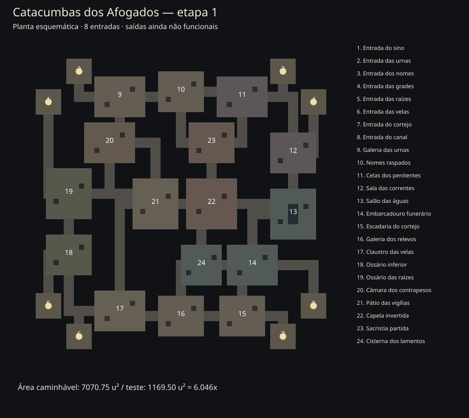

# Catacumbas dos Afogados — etapa 1

> Registro histórico da estrutura. O estado atual está em [Catacumbas — etapa 2](CATACUMBAS_ETAPA_2.md).

Implementação estrutural de 14/10/2026. Unity 6000.0.84f1, NGO 2.13.3 e Transport 2.7.4 preservados.

## Acesso e conteúdo

Na preparação da expedição, use **Mapa: Catacumbas dos Afogados**. O seletor existe na cabana normal e no ambiente de teste; o padrão normal continua Floresta Velha. Na cabana de teste, é possível selecionar de zero a sete bots. O laboratório continua exclusivo do ambiente de teste.

Esta entrega contém geometria, placeholders, colisão, navegação, minimapa e capacidade de **oito participantes**. Mantém PvPvE e dez minutos. A fila completa as vagas com bots segundo as regras existentes. Teste e floresta continuam com cinco participantes.

**Ainda não há saque, encontros iniciais ou extrações funcionais nas Catacumbas.** São conteúdos da etapa 2. As estruturas da escadaria, do poço e da barca são reservas visuais, sem triggers de extração; a HUD informa essa condição. No ambiente normal, as regras existentes de equipamento e perda ao morrer/expirar continuam valendo. O ambiente de teste mantém equipamento temporário.

## Planta e circulação

- 24 salas, oito entradas individuais e 31 ligações autoradas, sem variação de geografia por seed.
- Planta irregular em um envelope de 135,68 × 135,68 unidades, incluindo o maciço inacessível. Esse envelope não é a área jogável.
- Cada célula de construção mede 1,06 unidade. Os corredores têm 4,24 unidades livres; as arenas centrais oferecem espaço para contornar cobertura. As antecâmaras de entrada medem 10,60 × 10,60.
- Circuito periférico: galeria das urnas → nomes raspados → prisão → correntes → salão das águas → embarcadouro → escadaria → relevos → claustro → ossário inferior → raízes → contrapesos → galeria.
- Circuito interno: contrapesos → pátio → capela → sacristia → galeria; ligações adicionais conectam capela às águas, pátio às cisternas/claustro e ossário ao pátio.
- As oito antecâmaras são ramais de entrada com aproximações em curva; a área central não é passagem obrigatória para circular ou alcançar os locais das futuras saídas.
- O mapa usa a mesma máscara de piso para construção, cartografia e navegação. Paredes/pilares bloqueiam visão e deslocamento; sarcófagos baixos e água bloqueiam deslocamento, preservando a visão.
- A navegação global é própria das Catacumbas, com campos de caminho por destino e raio do corpo; a navegação física local existente conecta os pontos e evita quinas. Bots recebem os centros acessíveis das salas como pontos de exploração, sem gerar loot nesses pontos nesta etapa.

Os números da planta correspondem às salas enumeradas na legenda. Os setores são Vestíbulos dos Enlutados, Galeria dos Nomes Raspados, Ossário das Raízes, Claustro das Velas Mortas, Cisternas do Pranto, Prisão dos Penitentes, Capela Invertida e Câmara dos Contrapesos.

## Medição geométrica

| Medida | Valor |
|---|---:|
| Piso útil conectado do teste | 1.169,50 u² |
| Piso útil conectado das Catacumbas | 7.070,75 u² |
| Relação de área útil | **6,046x** |
| Intervalo aceito | 5,7x a 6,3x |
| Passo de amostragem | 0,25 unidade |
| Raio do jogador no mundo | 0,40 unidade |

O raio vem do colisor circular de 0,5 com escala de 0,8 no prefab atual. A medição desconta a interseção do corpo com obstáculos, paredes e água. Uma busca de conectividade contabiliza somente amostras alcançáveis a partir da entrada; nesta planta, todas as amostras úteis estão no mesmo componente. Não existe portão fechado nesta etapa.

A ferramenta `Tools/Measure-DungeonArea.py` lê as salas/ligações do C# e o raio/escala do prefab, reproduz a geometria do teste e gera `CATACUMBAS_AREA.json` e a planta SVG. Ela é uma medição geométrica offline, **não** um teste da física, navegação em execução, serialização ou rede do Unity.

## Integração e preservação

- Novo valor `ExpeditionMap.Dungeon = 2`; os valores anteriores permanecem 0 e 1.
- Capacidade por mapa aplicada à aprovação de conexões, fila, preenchimento de bots e contadores da interface.
- Novos estados de mecanismo não foram criados: pertencem à etapa 2. A seleção replicada existente identifica o novo mapa.
- Protocolo incrementado de 19 para **20**, pois clientes anteriores não reconhecem o mapa/capacidade. Cliente e servidor precisam usar o código atualizado; não foram produzidos executáveis.
- Nenhuma cena/prefab existente foi regenerada. Arte, assets e alterações locais anteriores foram preservados.
- O minimapa conserva a regra atual de cartografia conhecida; não revela inimigos nem anuncia saídas funcionais. A apresentação do mundo continua usando a visão existente.

## Próximas etapas

**Etapa 2:** 10 aranhas, cinco espreitadores e três couraçados; 24 pontos de saque; mecanismos e extrações da escadaria, poço e canal, com autoridade no servidor. Nenhum outro arquétipo deverá ser criado pelo mapa.

**Etapa 3:** ambientação medieval, detalhes e substituição dos placeholders. Sprites pendentes: pisos de pedra/terra/ossário; paredes, cantos, arcos e pilares; nichos e sarcófagos; grades/portas/correntes; cobertura funerária; água/margens/passarelas; raízes/musgo/teias/casulos; altar/velas/estandartes; escadaria/grade/cabrestante; poço/plataforma/cordas/contrapesos; embarcadouro/barca/comporta; manivela/chave/relevos; entulho/poças/cerâmica. Reutilizar as animações existentes dos três inimigos.

## Evidência e limites

Foi feita revisão estática e medição matemática da geometria. **Não foram executados testes automatizados, Unity, builds ou sessões de validação.** Jogabilidade, colisões nativas, oito participantes conectados, comportamento dos bots, apresentação em aparelhos e desempenho aguardam a primeira avaliação prática do usuário. A geometria e os percursos ainda podem precisar de ajuste após essa avaliação.
