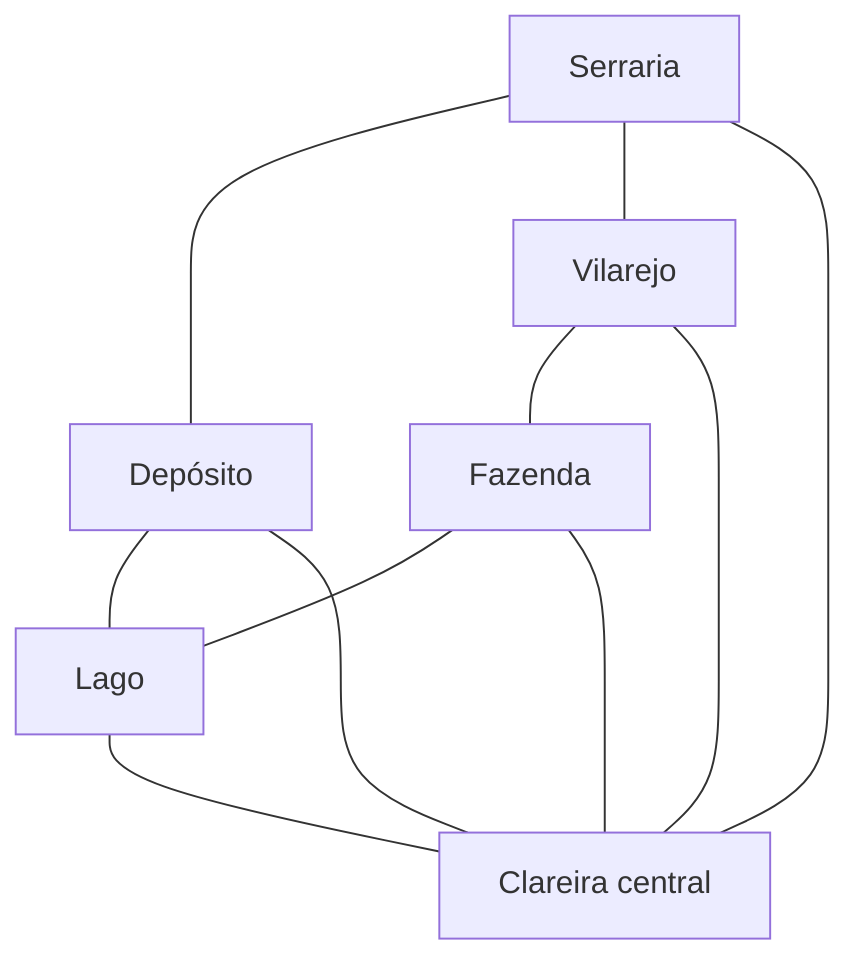

# Floresta Velha — proposta inicial de reorganização

## Base para o planejamento

O usuário prefere expedições de **8–10 minutos**; a implementação inicial agora adota **10 minutos**, junto do layout de 400×600. As descrições abaixo registram a direção de projeto; o estado implementado e as limitações estão em `Integracao/MAPA_EXPEDICAO_2026-10-11.md`. Ainda não houve avaliação prática em Unity.

Diagnóstico anterior: mapa 900×1380, cinco participantes, velocidade 4 unidades/s, câmera ortográfica com semialtura 9, visão de alcance 9, dezenas de ruínas dispersas. A diagonal tem cerca de 1647 unidades, equivalente a quase sete minutos andando em linha reta. Colisões, combates e saque prolongam o percurso. Esse tamanho não equivale a dez minutos de conteúdo: há grandes espaços sem experiências definidas e um nascimento no centro, que quebra a progressão para a área de maior disputa.

## Direção proposta

- Dimensão de partida para o blockout: **400×600 unidades**, cinco nascimentos em setores periféricos e nenhum no centro.
- **Seis pontos de interesse principais**, cada um com identidade e 3–5 estruturas próprias. Cerca de 24 ruínas/estruturas no primeiro blockout, substituindo o espalhamento atual.
- Estrutura e marcos fixos para aprender o mapa. Sorteios variam ocupação de monstros, loot, estado de alguns interiores e templates secundários, usando a semente do servidor.
- Darkwood orienta atmosfera, floresta, abandono e interiores. Bullet Echo orienta silhuetas, cobertura, linhas de tiro e pelo menos duas rotas por encontro. Arte e geometria próprias.

| Setor | Papel e identidade |
| --- | --- |
| Serraria ao norte | Madeira, oficinas, pilhas de toras e corredor de combate interrompido por cobertura |
| Depósito a nordeste | Metal e materiais; portas largas, galpões, rota externa e salas menores |
| Vilarejo a oeste | Casas abandonadas e ruas curtas; exploração de interiores e flanqueamento |
| Lago a sudeste | Referência visual e escolha de contorno; sem pesca na expedição |
| Fazenda ao sul | Celeiro e cercas quebradas; transição de áreas abertas para abrigo |
| Clareira central | Objetivo opcional de maior risco/recompensa, conectado a vários setores |

O anel externo permite explorar e extrair sem cruzar o centro. As ligações internas oferecem atalhos com exposição maior. O grafo representa conexões entre setores, não um terreno aberto que pode ser atravessado livremente em qualquer direção.

## Barreiras naturais e caminhos entre setores

O mapa é fechado por barreiras naturais, conforme a direção do usuário. Escarpas, paredões de pedra, água profunda e trechos de mata realmente impenetrável delimitam o exterior e também separam áreas internas. As saídas são interrupções reconhecíveis desse limite, associadas aos locais de extração. Evitar paredes invisíveis: o cenário precisa mostrar por que o personagem não passa.

Entre setores vizinhos conectados, oferecer **dois ou três caminhos distintos**, em vez de deixar todo o espaço intermediário atravessável. Não conectar todos os setores diretamente entre si; preservar o anel externo e as ligações escolhidas para a clareira. As barreiras organizam a circulação, mas os caminhos devem permitir desvio e flanqueamento.

| Tipo de caminho | Característica | Decisão do jogador |
| --- | --- | --- |
| Trilha principal | Mais legível, relativamente curta, com trechos expostos e cobertura espaçada | Chegar rápido, aceitando maior chance de encontro |
| Contorno pela mata | Mais longo, com curvas e visão interrompida; vegetação lateral bloqueia a passagem | Evitar a rota principal e aproximar-se por outro lado |
| Terceira passagem, quando fizer sentido | Atalho por ravina, terreno entre rochas ou estrutura abandonada, com aproximação diferente | Economizar percurso ou flanquear, aceitando exposição ou pouca visão |

Exemplos de conexões: fazenda–vilarejo pela estrada rural ou pela trilha entre cercas e mata; serraria–depósito pela estrada de carga, por um contorno rochoso ou pelo antigo ramal ferroviário; fazenda–lago pela margem seca ou pela trilha atrás de uma escarpa. São propostas para o blockout, não geometrias já implementadas.

Cada caminho deve ter entrada e continuidade legíveis, e pontos para interromper linhas de tiro. Evitar que as alternativas se juntem num único gargalo antes de alcançar o destino, ou que uma posição domine simultaneamente todas as entradas. Medir os tempos de exploração e retorno usando esses percursos reais: as barreiras tornam a distância em linha reta insuficiente para escolher nascimentos e extrações.

Manter espaço de manobra nos caminhos principais e áreas mais amplas dentro dos setores. A floresta serve tanto à atmosfera de Darkwood quanto à organização espacial; cobertura e rotas alternativas preservam a legibilidade de combate inspirada em Bullet Echo. A disponibilidade das extrações não deve fechar as conexões internas nem impedir o acesso à saída confirmada.

## Variação dos caminhos por partida

As conexões são aprendidas e mantêm suas posições, mas alguns caminhos recebem uma condição sorteada no início da partida. Direção aprovada pelo usuário: um caminhão tombado pode bloquear uma passagem; um bando de monstros pode tornar outra perigosa. A variedade altera as decisões de percurso sem redesenhar todo o mapa.

| Condição | Exemplos ambientais | Efeito no percurso |
| --- | --- | --- |
| Livre | Estrada vazia, trilha seca, ramal desocupado | Travessia normal |
| Bloqueio físico completo | Caminhão tombado entre paredões, deslizamento de pedras, árvore caída junto a uma escarpa | Exige escolher outro caminho; posicionar somente onde o cenário explica por que não é possível contornar |
| Passagem estreitada | Carroça quebrada, carga de toras espalhada, parte do barranco desmoronada | Continua transitável, com menos espaço; preservar largura compatível com o personagem |
| Ocupação por monstros | Bando alimentando-se de uma carcaça, criaturas abrigadas num veículo abandonado, planta hostil tomando a margem da trilha | Caminho perigoso, mas possível de atravessar ou liberar pelo combate |
| Obstáculo visual | Juncos altos ou vegetação densa nas laterais, carga abandonada interrompendo a visão | Muda a leitura e as aproximações sem tornar o piso invisível ou esconder um bloqueio físico |

As condições precisam combinar com o setor: veículos e cargas nas estradas da serraria/depósito; quedas de árvores e pedras nos contornos da mata; carroças e cercas rompidas na fazenda; carcaças e plantas hostis perto das margens. Usar alguns locais próprios para essas variações, evitando espalhar obstáculos arbitrariamente sobre qualquer corredor.

Regras propostas para o sorteio:

- **Preservar conectividade.** Nunca fechar todos os caminhos de uma conexão necessária. Após combinar bloqueios e extrações, cada nascimento deve continuar conectado a uma saída comum ativa, incluindo a referência confirmada de seu jogador. Escolher essa referência com base no percurso já sorteado.
- Monstros representam perigo, não uma parede permanente. A rota garantida não deve exigir eliminar um bando forte, atravessar uma passagem especial bloqueada ou possuir equipamento específico. Preservar alternativas viáveis, sobretudo na saída do nascimento.
- Distribuir condições com limites por conexão e por partida; começar com poucas alterações para manter a leitura do mapa. Probabilidades e quantidade serão definidas após o blockout, sem tratar todo caminho como uma rolagem independente.
- Manter bloqueios físicos estáveis até o fim da partida nesta primeira versão. Bandos usam as regras normais de combate: ao derrotá-los, o percurso fica menos perigoso. Reparar veículos, remover árvores e eventos que fecham caminhos durante a partida ficam para avaliação futura.
- O servidor sorteia e controla o estado. Replicar identificador da variante e seus obstáculos; colisão, aparência e navegação de bots/monstros devem concordar. Selecionar os encontros após conhecer as passagens transitáveis.
- A condição é descoberta pela visão real do jogador. Não revelar no mapa todos os bloqueios ou bandos desde o início. Um obstáculo físico observado pode ser marcado como bloqueio conhecido; uma observação de monstros registra sua última localização, sem prometer que continuam ali.
- Sinalizar o bloqueio antes de comprometer o jogador com um corredor sem retorno: silhueta visível, marcas do deslizamento ou toras espalhadas. Oferecer espaço para recuar e uma alternativa próxima, sem desvio desproporcional ao tempo de expedição.

Exemplo de partida: a estrada de carga entre serraria e depósito está fechada por um caminhão tombado; o ramal ferroviário continua livre; a trilha rochosa tem um bando junto a uma carcaça. Na partida seguinte, a estrada pode estar livre e o ramal estreitado por carga abandonada. O jogador reconhece a região, mas decide novamente como atravessá-la.

## Caminhos desbloqueáveis e descoberta de ferramentas

Direção aprovada pelo usuário: algumas passagens opcionais têm uma cerca metálica que pode ser cortada com um alicate. O jogador encontra a cerca antes de necessariamente conhecer a solução; pode descobrir a utilidade da ferramenta ao encontrar um alicate na expedição ou obtê-lo numa futura oferta de compra na base. Não anunciar antecipadamente a solução com tutorial, marcador de missão ou mensagem “precisa de alicate” ao chegar sem a ferramenta.

A cerca precisa parecer cortável: malha metálica, postes e uma seção de passagem reconhecível, diferente de um portão pesado ou uma barreira indestrutível. A descrição do alicate pode mencionar que corta arame; ao aproximar-se da cerca com a ferramenta, uma interação contextual discreta permite relacionar item e cenário. O feedback da ação mostra o corte e a abertura, tornando o resultado compreensível sem explicar o segredo previamente.

Essas passagens oferecem atalhos entre rotas existentes ou uma aproximação alternativa a um setor. Não colocar uma ferramenta atrás da única cerca que exige essa mesma ferramenta. Não contar uma passagem fechada como rota garantida: todo nascimento e sua saída confirmada continuam conectados por caminhos comuns após os sorteios de obstáculos.

Proposta de funcionamento para avaliação futura:

- O servidor verifica posse da ferramenta, proximidade, estado da cerca e conclusão da ação antes de abrir a passagem. Ter o item não abre a cerca automaticamente.
- A abertura modifica apresentação, colisão e navegação de forma replicada. Depois do corte, permanece aberta para todos até o fim da partida; na próxima partida, o estado inicial é definido novamente. Não confundir abertura compartilhada da cerca com conhecimento individual do mapa.
- Um jogador que observa a cerca aberta entende que alguém pode ter passado por ali; o corte deixa malha dobrada e um vão visível, sem indicar quem fez isso.
- Obter o alicate por loot ou compra na base é uma possibilidade desejada, ainda sem tabela de loot, vendedor, preço ou receita definidos. Duração do corte, ruído, durabilidade e eventual consumo da ferramenta também ficam para balanceamento; não implementar essas restrições por suposição.
- Separar acesso físico a um atalho de permissão para usar uma extração especial. Cortar uma cerca não ativa automaticamente uma saída inativa nem garante que um transporte esteja presente.

Primeiro exemplo proposto: uma cerca de serviço entre a fazenda e um contorno do vilarejo encurta o percurso, enquanto a estrada rural continua disponível. O jogador pode passar várias vezes pela cerca fechada e só depois reconhecer uma nova oportunidade ao obter o alicate. Outros tipos de ferramenta e passagem serão definidos após avaliar essa interação inicial.

### Variedade de requisitos de passagem

O alicate é um exemplo de um sistema mais amplo, conforme esclarecido pelo usuário: caminhos opcionais podem exigir ferramentas diferentes ou chaves. Associar cada requisito à construção do obstáculo, mantendo a descoberta pelo cenário e pelos itens, sem anunciar antecipadamente todas as soluções.

| Obstáculo proposto | Item associado | Passagem oferecida |
| --- | --- | --- |
| Cerca de malha metálica | Alicate de corte | Atalho entre propriedades ou acesso lateral a um pátio |
| Porta emperrada ou tábuas pregadas numa passagem | Pé de cabra | Travessia por uma construção abandonada |
| Pequeno tronco caído atravessando um vão estreito | Serra manual | Contorno pela mata; não sugerir que a ferramenta remove árvores inteiras ou pilhas de toras |
| Escotilha de manutenção parafusada | Chave de ferramenta compatível | Passagem curta por uma área de serviço |
| Portão trancado ou porta de acesso restrito | Chave específica do local | Rota por dentro do depósito, oficina ou propriedade |

Estes são exemplos de conteúdo para selecionar durante o desenho dos setores, não uma lista fechada de itens já implementados. Variar também a recompensa espacial: reduzir distância, alcançar cobertura, mudar o lado de aproximação ou acessar uma área opcional de saque. Não criar muitas ferramentas equivalentes que apenas ocupam a mochila sem oferecer decisões distintas.

Ferramentas podem servir a vários obstáculos compatíveis; chaves específicas devem identificar o local correspondente na aparência ou descrição, permitindo que o jogador relacione suas descobertas. Nenhuma chave necessária pode existir somente atrás da própria passagem trancada. Obtenção por exploração e possíveis ofertas na base serão definidas por item; ainda não há decisão sobre vendedores, preços, consumo ou durabilidade.

Representar o requisito por identificador do item e tipo de ação, separado do estado aberto/fechado da passagem. O servidor verifica o requisito e abre o caminho de forma compartilhada e persistente durante a partida. Se um acesso futuro exigir permissão individual, ele precisa de regra própria; uma porta fisicamente aberta não deve continuar funcionando como uma barreira invisível para outros jogadores.

O conjunto sorteado de bloqueios e passagens especiais mantém pelo menos uma rota comum até a saída confirmada. Caminhos dependentes de itens acrescentam oportunidades, sem tornar a extração básica dependente de encontrar uma ferramenta ou chave por acaso.

## Extrações integradas ao cenário

Dez locais possíveis, fixos e aprendidos pelo jogador, ligados a caminhos que continuam para fora da área jogável. Somente parte deles fica ativa em cada partida. A disponibilidade aparece no próprio cenário: o ponto da carroça existe sempre, mas a carroça só está presente quando essa extração funciona. Estruturas permanentes, como pontes e estradas, mostram passagem livre ou bloqueada.

| Local | Extração e motivo da fuga | Marco visual | Aproximação e cobertura |
| --- | --- | --- | --- |
| Fazenda, limite sul | **Carroça do Portão**: carroça conservada, pronta para deixar a propriedade pela trilha de transporte | Rodas inteiras, carga presa, portão aberto e marcas de roda saindo do mapa | Acesso pelo pátio ou contornando o celeiro; cerca quebrada e fardos interrompem linhas de tiro |
| Serraria, limite norte | **Estrada das Toras**: antiga estrada de escoamento da madeira, ainda transitável para sair da floresta | Carreadores, placa gasta, troncos nas laterais e estrada que segue além da borda | Chegada pelo galpão ou pela mata lateral; empilhamentos de toras protegem sem formar um corredor fechado |
| Lago, limite leste | **Barco do Ancoradouro**: pequeno barco a remo preservado, em um braço de água que se conecta ao exterior | Barco, remos, corda de amarração e passagem entre juncos; o desenho da água mostra a continuação | Acesso pela margem ou por uma trilha atrás do abrigo de barcos; área de embarque larga, sem exigir ficar na ponta de um píer estreito |
| Vilarejo, limite oeste | **Ponte Velha**: travessia de pedra ainda utilizável que alcança a estrada fora da região | Arco de pedra, pequeno curso d'água, guarda-corpo quebrado e trecho de estrada além da ponte | Aproximação pela rua ou pelos quintais; cobertura antes da travessia, com saída na cabeceira próxima para evitar um gargalo obrigatório |

O catálogo de dez pontos amplia esses quatro marcos:

| Setor | Ponto possível | Quando ativo | Quando inativo |
| --- | --- | --- | --- |
| Fazenda | Carroça do Portão | Carroça funcional no ponto de embarque | Pátio vazio, apenas marcas de rodas |
| Fazenda | Passagem do Gado | Porteira aberta e passagem contínua para fora | Porteira travada e troncos barrando o caminho |
| Serraria | Estrada das Toras | Corrente abaixada e estrada desobstruída | Corrente fechada e toras atravessadas na saída |
| Serraria | Caminhão Madeireiro | Caminhão em condições de partida junto à plataforma | Vaga vazia e plataforma abandonada |
| Lago | Barco do Ancoradouro | Barco amarrado, com remos prontos | Ancoradouro vazio, corda solta |
| Lago | Canoa dos Juncos | Canoa preservada numa pequena enseada | Apenas um suporte vazio entre os juncos |
| Vilarejo | Ponte Velha | Cabeceira livre e travessia utilizável | Entulho e vigas bloqueiam a cabeceira |
| Vilarejo | Trilha dos Peregrinos | Abertura livre na cerca e trilha transitável | Queda recente de árvores fecha a passagem |
| Depósito | Vagonete de Manutenção | Vagonete funcional no pequeno ramal ferroviário | Ramal vazio, sem transporte |
| Depósito | Portão de Serviço | Portão aberto para a estrada exterior | Portão fechado, com barricada visível |

A clareira central não recebe extração; entrar ali implica planejar o retorno a um setor periférico. As ligações do depósito à serraria e ao lago também oferecem alternativas quando suas saídas próprias estiverem inativas.

Regras para a primeira implementação:

- **Proposta inicial: quatro extrações ativas entre dez possíveis.** O servidor escolhe uma combinação no início da partida e mantém a seleção até o fim. Distribuir as quatro por pelo menos três setores, limitar a duas por setor e rejeitar combinações que deixem um nascimento sem alternativa alcançável em até 90 s de caminhada pelo percurso real. O número quatro é um padrão proposto de balanceamento, ainda sujeito à escolha do usuário.
- Ausência de transporte e bloqueios são parte do mesmo estado autoritativo que permite ou recusa a retirada; arte, colisor e gatilho não podem divergir entre clientes. Replicar a seleção pelo MatchManager. Um ponto inativo não inicia contagem nem extrai jogadores.
- A seleção não muda enquanto o jogador caminha até o local. Sem chaves, combustível, reparos ou consumo de loot nesta primeira versão; requisitos especiais poderão ser discutidos depois da avaliação do mapa.
- Preservar inicialmente o tempo de extração atual de **3 segundos** e a confirmação no servidor. A carroça e o barco são marcos de embarque; a retirada termina a participação na expedição. Não há necessidade de simular condução de veículos nessa etapa.
- A área de ativação fica junto ao ponto funcional: lateral da carroça, faixa de saída da estrada, margem de embarque do barco e cabeceira da ponte. A posição deve ser legível pelo cenário e indicada discretamente quando o jogador se aproxima.
- **Uma saída confirmada no início:** cada jogador recebe a informação de uma das saídas ativas, com nome e localização. O servidor escolhe essa referência entre as saídas alcançáveis pelo nascimento, com percurso razoável; jogadores podem receber referências diferentes. Essa informação não torna a rota livre de monstros ou de outros jogadores. A saída permanece aberta até o fim da partida e pode orientar o retorno desde o início.
- **Demais saídas incertas:** o jogador pode conhecer as posições possíveis, mas HUD/minimapa não revelam automaticamente a disponibilidade das outras nove. Ponto ainda não inspecionado aparece como disponibilidade desconhecida; confirmar somente quando o marco entra na visão real do personagem, respeitando paredes e alcance. A descoberta é individual. Ponto sem transporte ou bloqueado passa a ser marcado como indisponível naquela partida. A saída inicialmente confirmada é uma exceção explícita a essa necessidade de inspeção.
- O HUD usa os nomes dos destinos, por exemplo **“Carroça do Portão · Sul · Confirmada”** para a referência inicial e **“Barco do Ancoradouro · Leste · Não verificada”** para uma alternativa incerta, preservando direção/distância do destino escolhido. A saída confirmada é a orientação inicial de retorno; o jogador pode escolher outro destino. Nunca orientar silenciosamente para o ponto ativo global mais próximo: isso revelaria a seleção antes da exploração. Ao se aproximar de uma saída ativa: **“Embarcando”** no transporte ou **“Deixando a floresta”** na passagem, com o progresso de retirada.
- Cada extração recebe duas aproximações e espaço para recuar. Os monstros naturais não nascem sobre o ponto de retirada. Evitar uma posição de cobertura que domine todas as aproximações ao mesmo tempo; confrontos ainda podem acontecer durante o retorno.
- Disponibilidade coletiva e descoberta individual: um jogador extrair não esgota a saída para os demais. Uma animação de embarque ou afastamento é efeito de apresentação, sem remover o transporte da partida para outros participantes. Inativo significa que o transporte não estava disponível naquela partida, não que alguém já o consumiu.
- Não confundir a saída com um abrigo inicial. Distribuir os nascimentos e medir as rotas de retorno depois de posicionar os dez locais, mantendo alternativas com custos de percurso comparáveis. Medir também o desvio entre uma saída inativa e as próximas opções para evitar penalizar a descoberta com uma caminhada excessiva.

## Evolução futura: extrações desbloqueáveis

Extrações desbloqueáveis fazem parte da direção futura aprovada pelo usuário, sem requisitos definidos nesta etapa. Distinguir três informações: disponibilidade do local nesta partida, conhecimento do jogador sobre essa disponibilidade e permissão do jogador para usar uma extração especial. Desbloquear um local não deve implicitamente revelar todas as saídas nem garantir que um transporte esteja presente; a regra específica de cada extração será definida quando esse sistema for projetado.

O catálogo deve permitir associar futuramente um requisito de acesso ao identificador da extração. Progresso persistente fica separado da configuração do mapa e é verificado pelo servidor. Missões, reputação, chaves ou reparos são possibilidades de planejamento, não decisões já aprovadas. Toda partida continua oferecendo ao jogador pelo menos uma saída comum, confirmada e utilizável sem desbloqueios especiais.

## Métricas do blockout

Campo de visão ampliado e com aparência de lanterna: alcance 12 unidades, abertura 120°, câmera da expedição com semialtura 12. Bordas laterais arredondadas e queda gradual de iluminação nos 35% finais do alcance em cada direção; paredes continuam interrompendo a visão. Alteração implementada no código, incluindo a regra compartilhada de percepção de jogadores, servidor e bots; ainda sem avaliação prática em Unity. Essas métricas substituem os valores de visão/câmera descritos no diagnóstico inicial acima.

- Primeiro loot a 10–20 s de caminhada do abrigo; primeiro ponto principal a 20–35 s. Kit inicial e uma área curta de orientação preservados.
- Conexões entre pontos principais: 15–30 s andando, medidas pelo percurso navegável, não somente pela distância reta.
- Entradas/corredores de pelo menos 2 unidades; conexões principais com 3–5 unidades; nenhuma mobília sobre a passagem central.
- Linhas de tiro normalmente interrompidas em 8–16 unidades. Campos maiores são opções de risco com cobertura e contorno identificáveis.
- Nenhum encontro natural no raio protegido de nascimento. Não concentrar perigos inevitáveis no corredor imediato da extração.
- Dez pontos periféricos fixos e quatro ativos por partida como proposta inicial. Distância típica de retorno dos pontos de interesse de 25–60 s; cada ponto inativo deve ter uma alternativa possível a 15–30 s de caminhada. A seleção das saídas ativas precisa ser avaliada junto dos nascimentos e dos caminhos navegáveis.
- Cada interior relevante oferece duas saídas ou uma rota externa de contorno; áreas com uma só saída são opcionais e têm risco/recompensa explícito.

Ritmo pretendido: 0–2 min orientação e primeiros recursos; 2–7 min exploração de 1–3 setores e decisões de risco; 7–10 min rota de retorno, encontros finais e extração. A clareira é opcional; a progressão econômica não exige enfrentá-la em toda partida.

## Próxima implementação

1. Desenhar o blockout dos seis setores, as barreiras naturais externas e internas e dois ou três caminhos por conexão entre setores vizinhos; posicionar os dez locais possíveis, suas duas aproximações e cinco nascimentos. Reservar pontos de variação para bloqueios, estreitamentos e encontros, além de atalhos opcionais com cercas cortáveis. Definir combinações válidas de caminhos e saídas ativas usando os tempos reais de percurso, sem depender dos atalhos fechados.
2. Substituir os arrays de distribuição macro do MapBuilder e os pontos usados por bots/encontros pelo novo layout; manter a semente replicada e as regras probabilísticas já implementadas.
3. Ajustar o cronômetro para 600 s junto do layout. Integrar o sorteio replicado das condições dos caminhos e o catálogo de extrações (identificador, nome, posição, setor e apresentações ativa/inativa), uma saída confirmada por jogador no início e descoberta individual das demais. Garantir conectividade após os sorteios. Preparar a separação entre disponibilidade, conhecimento e acesso para os desbloqueios futuros. Reservar os templates implementados para variedade local e construir marcos próprios para os pontos principais.
4. Avaliação prática do usuário: tempo até loot/combate/saída, clareza das rotas, capacidade de contornar perigos e legibilidade no celular horizontal. Só iniciar testes automatizados ou Unity adicionais se solicitados ou após problema relatado.
5. Refinar a geometria com os resultados antes de ampliar a arte ambiental. Chance de loot/monstros deve ser calibrada por setor numa etapa posterior; não presumir que o mesmo peso global produz a dificuldade desejada em todo o mapa.

O redimensionamento inicial, marcos provisórios dos setores, dez locais de extração, condições dos caminhos, atalhos com ferramentas/chaves e duração de 10 minutos foram implementados no código. A avaliação prática do blockout e o refinamento da arte e do balanceamento ainda são próximos passos. Desbloqueios persistentes de extrações especiais e venda de ferramentas na base continuam futuros.

Atualização de implementação local: móveis rotacionáveis, um template octogonal de ruína, armários exploráveis, flashes de dano e novas regras de iluminação/oclusão já foram adicionados ao código. Alcance atual 16, abertura 140 graus e câmera 15 substituem as métricas anteriores de visão deste documento. Detalhes em `Integracao/RUINAS_VISAO_DANO_2026-10-11.md`; ainda sem validação prática em Unity.
